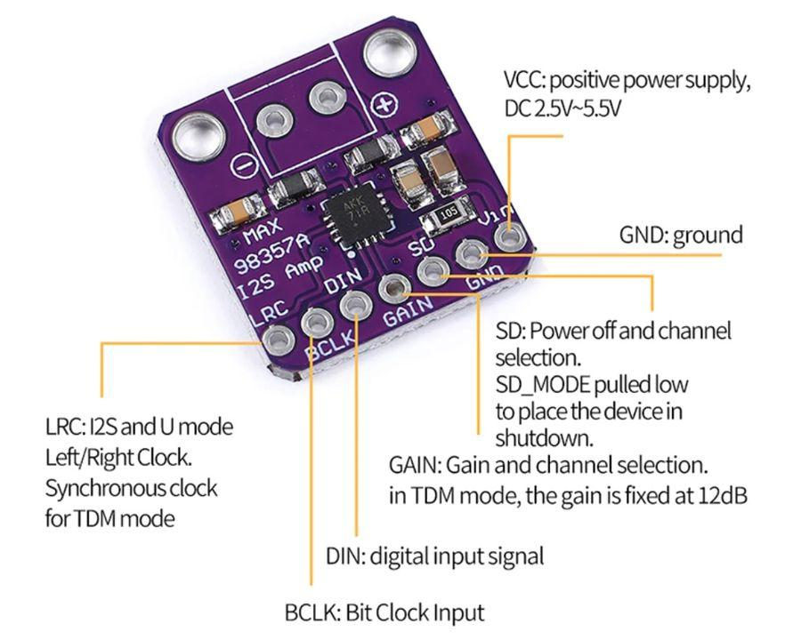

# MAX98357A Audio Amplifier Test

## Overview

This project tests the MAX98357A I2S audio amplifier module with an ESP32-S3 development board and a speaker.

The goal is to verify the wiring and confirm that audio can be played through the speaker.

## Hardware

- ESP32-S3 development board
- MAX98357A I2S audio amplifier
- Speaker
- Jumper wires

## Pin Connections

| MAX98357A | ESP32-S3 |
|---|---|
| DIN | GPIO 9 |
| BCLK | GPIO 10 |
| LRC | GPIO 11 |

Power and ground connections must also be connected correctly.

## Test Image

## Purpose

This is a basic hardware test, not a complete audio system. It serves as an initial step toward experimenting with audio playback on microcontrollers.
